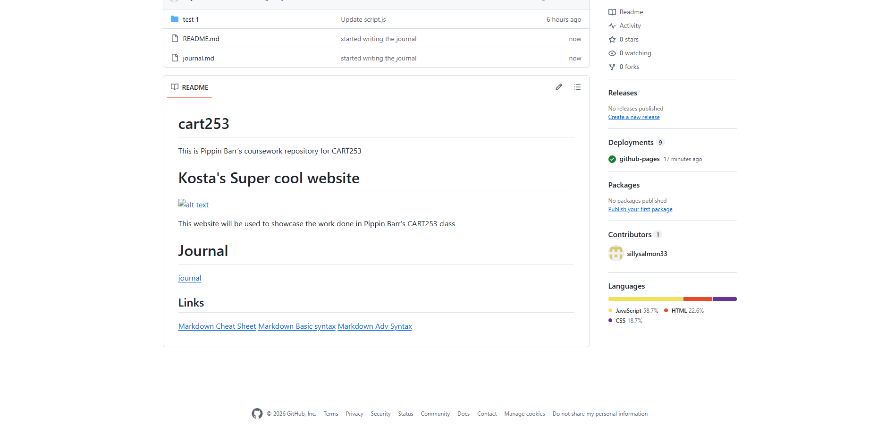
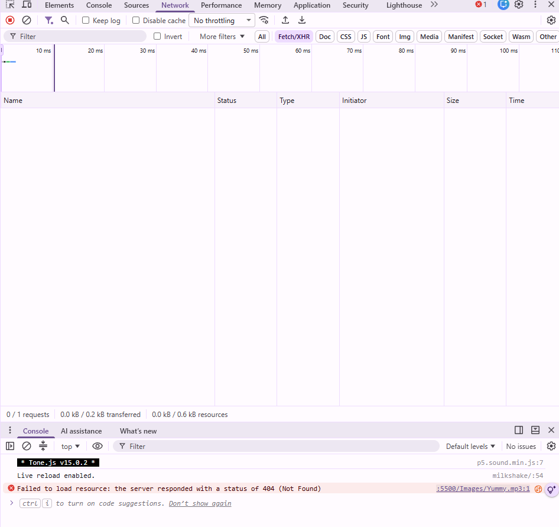
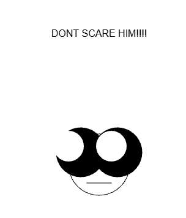
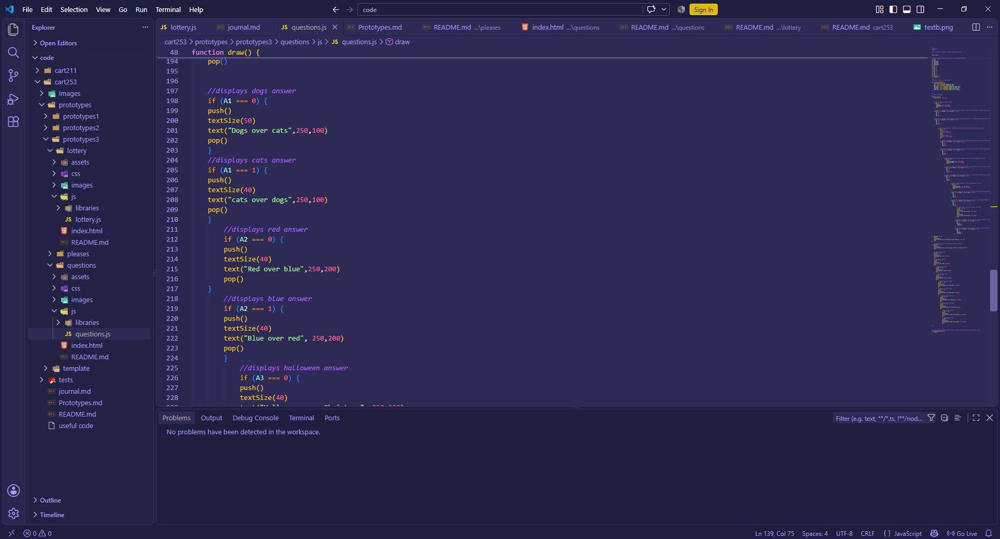
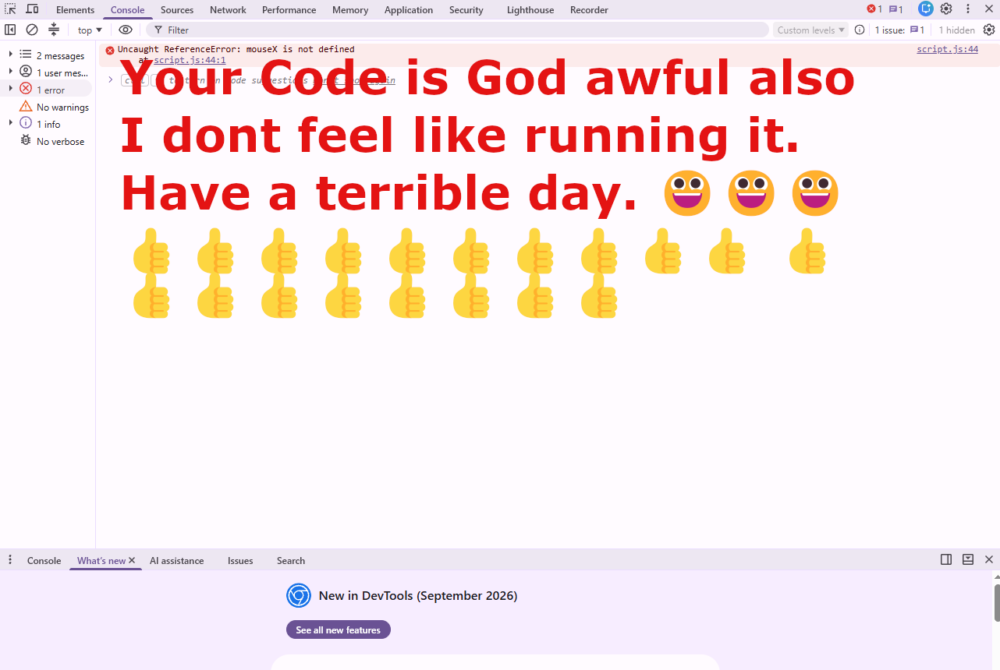
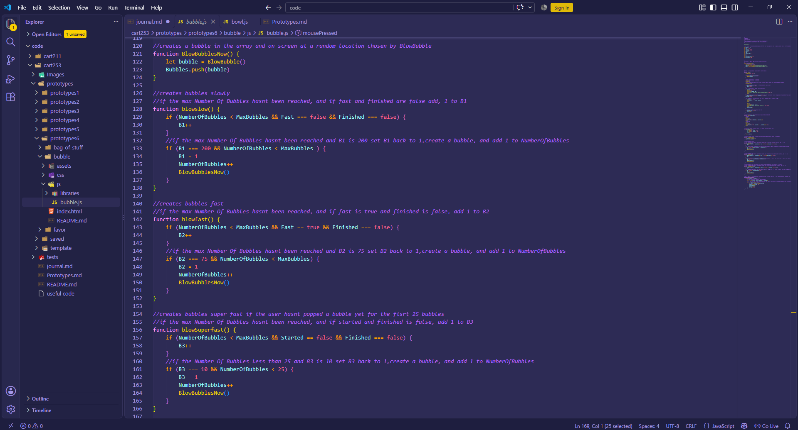
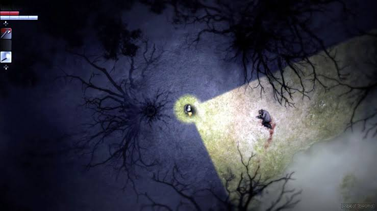
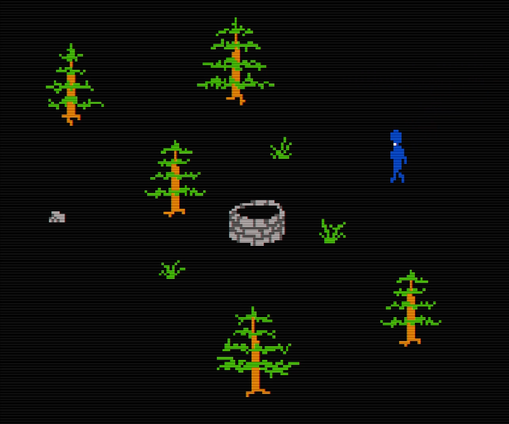
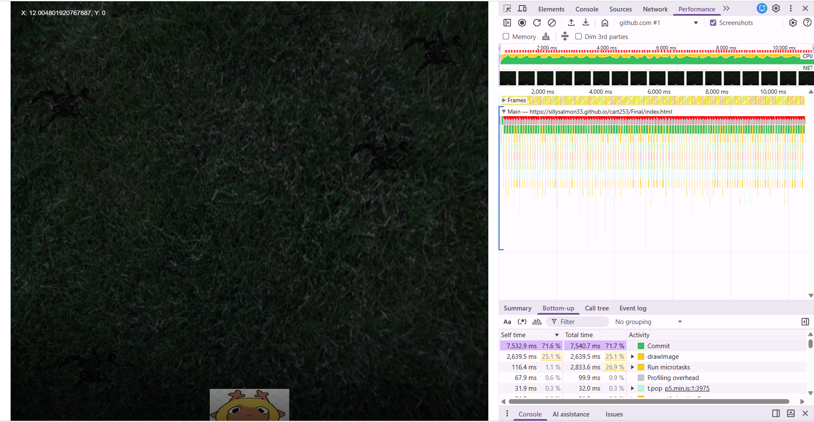

# Reflective Journal

# [README](README.md)
# [Prototypes](Prototypes.md)

### Sections
- [September 8th 2026](#september-8th-2026)
- [September 20 2026](#september-20-2026)
- [September 27 2026](#september-27-2026)
- [October 4 2026](#october-4-2026)
- [October 17 2026](#october-17-2026)

## September 8th 2026

Overall its been nice getting back into programing. Github and Markdown are (mostly) easy to use and the worst part is just how annoying programing is about how it wants stuff organized and written, like how the image and headers broke only on the page version because I put more than 1 paragraph brake or how the caution joke just doesnt work on pages so I had to replace it with a screenshot as a work around. Being able to upload stuff to Github and download it later is pretty nice and I wish I would of known about that a few years ago. I was a little confused on how markdown worked because I thought I was missing something  since the webpages I saw where pretty short. But now Im pretty sure Markdown is just really simple and just doesnt have that many features (or maybe im wrong). This is something I kinda like since I dont need to learn 100 things to do a simple task plus Markdown is pretty easy once I read the guides so thats nice. After I learned some basic stuff I started to make my webpage look nice by adding a gif and a warning joke to give it some more personality. Making my site look nice is the thing im most exited for since I want my future websites I make to look good because 1. It'll help me get a job 🥱 and 2. because I want to use it to display my art in an interesting way and want to hide some fun easter eggs on the site for people to find because I think its cool.

## September 20 2026

Making the 3 prototypes where a lot more annoying than I thought they'ed be, loading the audio and model took way longer than they should have and I only kinda get why they wouldnt work. This is what I was worried about last week of programing being really annoying about how you write stuff. Working with beziers where also super annoying since its almost impossible to visualize what they'll look like before you program them but using the mouse to move 2 of thr points did make it a bit easier. Actually making the stuff was kinda just ok, I wanted to do more with them but they all annoyed me soo much and it was soo tedious working on them that I dont really want to touch them any more since it was really boring and unintuitive to work on them.

## September 27 2026

This week wasnt that bad I decided to focus less on making the projects look good to focus just on them doing what I wanted them to do, which I think was a good call since I didnt spend as much time on aligning all the shapes compared to the last week. The ideas I decided to explore where simple but I hope will be be useful since knowing where a person's mouse is, is probably very important when making a website, and knowing how to keep track of time could also be very important. One thing I couldnt get working was constraints I wanted the little guy's eyes to look at the mouse but for some reason it wouldn't let me make a constraint with mouse x or y so I guess I'll try again next week. I do wish I experimented with some more interesting ideas but whatever I can just do some more interesting things in a future week.

## October 4 2026

This week was the best week so far since I found it pretty easy. The if statments where pretty easy to understand with the only hard part being how you need to place your input outside of draw and then call them in draw or its call it every frame which was annoying. I also got to experement with variables more to which was nice. The thing I struggled with though was figuring out how to time stuff. Originally I wanted to make a simple pokemon catching game where you would have a 1/10 chance to catch a pokemon and it would play an animation of you throwing the pokeball and it shaking. However I couldnt find a way to make a wait command that would work, I thought about using a timer but I wasnt sure how to set it back to 0 if the user failed, I did find the settimeout() command but for some reason it didnt work. So  after that I desided to scrap the idea and only use the random chance idea to make a simple chance game with no animations. If I find a wait command then ill probably finish the pokemon idea since I got pretty close to finishing it.

## October 17 2026

This week was kinda a rollercoster at first I was having trouble with none of my code working because google didnt know what any of the p5 variables meant, and I got really annoyed before realizing it was because I put the code outside of draw and thats why it wasnt working. After I fixed that I tryed out the setinterval code on the sun project which actually worked so I restarted the pokemon project. The pokemon project has been my most ambitious one yet and most complex, I probably could try to fix that by combining a bunch of variables into 1 or 2 but I dont want the whole project to break (again) so I'll just leave it be. The way I got everything to work properly was by using a bunch of variables and if statments to know at which stuff had been completed, but this caused a problem since everything had to be in a specific order I couldnt organize it the best. I wanted to put different sections into their own collapable menu or separate file but I didnt bother since it would probably break somthing. I also make 3 extra projects because of me not knowing how to debug I might do somthing with them another week (or not who knows). The piano one I made because I saw it on the discord and I thought it wouldnt be that hard to recreatre and the twistit one I stopped because I couldnt get the game to register my key presses as the same as the variable key press, so maybe ill fix.

## October 25 2026

This week could of gone better, I originally wanted to make a pirate game where you would have to dodge cannon balls that would come from random location but I couldnt get the random location part to work and was paranoid I wouldnt finish in time to I scarped it and desided to make some more simplier projects with completly random and controled randomness as practise instead which turned out ok if a little boring, (my room project was nice tho I like that). I had less time to work on my stuff this week because of personal reasons and I honestly kinda dont really understand how perameters and funtions work fully which is why I didnt feel I would finish in time. Hopfully next week ill make some more intresting stuff since Arrays will probably be easier to understand.

## November 1 2026

This week went a lot better than I expected, I got the hang of arrays pretty quickly since it was pretty simple to understand them. The bubbles project was the best to work on and is the most gamely and fun of the 3 projects, while the other 2 where me testing out some other stuff with arrays without a real end goal in mind for how you would finish the projects. Being able to add and remove stuff from the arrays was probably the most usefull thing thing by far, but using it to hold info is also (probably) usefull and I probably should of used it for the animations for the pokemon game since it would of saved a looooot of space. This week I stayed with some simple ideas since its the last set of projects and I wanted to just finish them all and because it was halloween 🎃. Supricingly I basically didnt struggle with anything at all this week, I dont know if its because the projects where pretty simple or because this is our 6th set of projects but hey I'm not complaining less work for me.

## November 16 2026

This week didnt go as well as I would of wanted it to go but I guess could of also been worste. I only started working on the project on Friday since that was when I actually came up with the idea for this project. I've only make the changing screan, dialogue, and movement this week which is fine, hopefully soon I'll finish the function to place the trees for the forest since that's the second to last super important feature I need before the skeleton of the game is done. I wanted to do somemore work on it but I have 3 other projects due around the same time because final... so that's fun yayyyyyy:(((((

The actually game itself is about the player being lost in a forest and trying to find their way out, everytime they go off screan they are teleported back on the opposite side and the location of the trees and props and NPCs change to simulate entering a new section of the forest. The player can talk to NPCs and find clues as to how to escape (or find a secret ending) and if they do they'll reach the end of the forest. If they dont find the exit and go through ex:30 sections of the forest, they reach a road and get run over and die :(. 

The trees and hopfully the player are going to be 3D modeled by me hopfully this week, and there will be a walking animation for the player. It would also be pretty cool if I can put voice acting for the game but I would need to ask some friends for that so idk yet. The actuall site for the project is also going to be custom, currently I just have the title above the p5 project but later i'll add a background and maybe some nice decoration to add to the spookyness of the game. 

The actuall coding part has been mostly fine I had some problems with the dialogue looping but that was just becaue I didnt write the if statments correctly so coding has been fairly easy so far (and hopefully it'll last.) 

The general mood and look for the game I want to try to be similar to DarkWood or Faith, which is where I got the idea from. If I can think of somthing I might put in some notes about lore or a random scary monster in the woods to add some more suspence, which I think will make the game much more intresting since then it'll be the first project with an actuall story. For this project I'm also going to try to make it look really good since I haev more time, unlike the other project which all look unfinshed, I'll add a mask over the screan to make everything around the player be in the dark, or maybe add the mask to the mouse to make a flash light if im able to, (idk havnt decided yet)

## November 24 2026

This week was going soo well until yesterday 😔. I maneged to finish all the needed stuff for the project with only the player, NPCs, and 1 of the ending needing to be finished plus general polish. But when I started testing on my laptob it was extremly laggy, which I found out was because of the tree images and the vignette I put. Aparently my pc can candle 50 pngs just fine but my laptop can't... yayyyyyyyyyyyyyyyyyy. Im trying to find a way to fix this becaues if I dont I'll be making a game about being lost in a forest with no trees. I'm trying to use p5 graphics instead of images but im not sure how they work, or if that doesnt work find a way to only render 1 image 50 times instead of 50 images 1 time, but im not sure if p5 is able to do that. If that doesnt work then I guess I'll just use 1 static background that doesnt change since I probaly cant make 30 background (or maybe I can IDK) but I would obviously prefer if I didn't have to throw a bunch of work away.

Update on this after I wrote that: aparently the reason it's lagging is (probably) becasue my laptop doesnt have a dedicated GPU so it's mostly my laptop's fault and not mine yayyy. Now that I know this tho I dont really know what to do since I now have to optimize it even harder than I thought I had to, for (probably) only me. I'll still try to fix it but now that I realize that the reason for the problem is the fact my laptop just doesnt have a GPU It's aparently going to kinda hard to render a bunch of graphics without the thing that's build specifically to render grahics :)))))))))))))))))

Aside for that god awful realization this week was good. I made the tree model which I thought would take me like an hour but only took like 10 mins in total so that was nice. I put in 2 of the 3 endings, npcs, items, inventory and make the trees spawn instantly by putting them in a loop (which makes them istant for some reason, idk I dont care why). Soon I'll be making the player and 2 NPC textures and then move on to the final ending and some music and sound effects and it'll be done. 

I was originally going to 3D model the player charecter but that seems too unrealistic so instead ill probably draw them in a shaky, sketchy style to add some spookyness, and if I'm nit happy with that I'll just find something online and use that instead

I finally realized you can close stuff in vs code this week also, so me complaining about my project being too big was all my fault lol

I also tried to make the trees look nicer by making them all spawn a minimun distance apart but the code I found wouldnt work with my tree code so I'll either rewrite my code later of just not implament it if I cant figure out a way to fix it.

